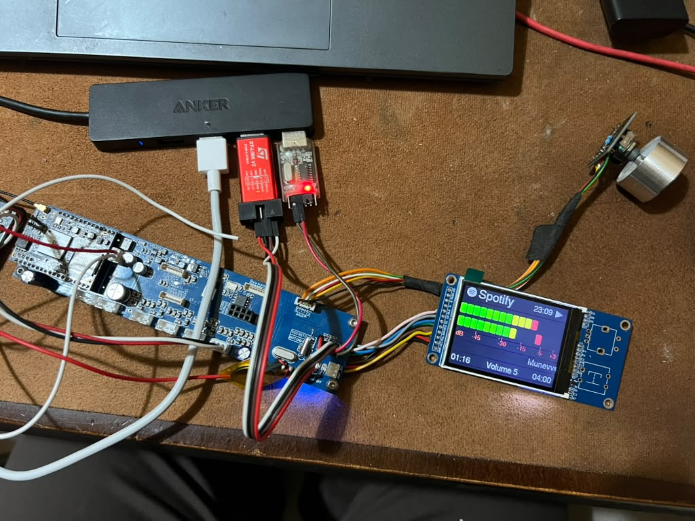

# STM32DSP1466

An ADAU1466 DSP preamp with STM32F407 front-panel control, Linkplay network audio, Bluetooth, XLR and optical inputs. The firmware provides source selection, input gain, master volume, bass and treble, stereo VU metering, and stereo, ADI Surround and bi-amp output modes.

## Design files

- [Editable EasyEDA schematic](hardware/easyeda/New1466DSP.json)
- [Editable EasyEDA PCB](hardware/easyeda/PCB_1466DSP.json), including the Bluetooth module footprint correction
- [SigmaStudio project](sigmastudio/Smart1466Ver5.dspproj)
- [Linkplay UART command notes](docs/linkplay_mcu_command_map.md)

Import the JSON files into EasyEDA to inspect or adapt the hardware and generate manufacturing files.

## Build the STM32 firmware

1. Open `sigmastudio/Smart1466Ver5.dspproj` in SigmaStudio and compile the DSP project. Use SigmaStudio's **Export System Files** command to export into a `dsp_export/` directory in the repository root.
2. Verify that the directory contains `Smart1466Ver5_IC_1_PARAM.h` and `Smart1466Ver5_IC_1_REG.h`. If you change the DSP graph, check the resulting parameter names and addresses against [the firmware map](include/dsp_map.h).
3. Run `pio run -e black_f407vg`. Program the ADAU1466 separately with the matching SigmaStudio project. The optional STM32 upload target uses STM32CubeProgrammer and ST-LINK. Adjust the executable path in `platformio.ini` for your installation.

The generated Analog Devices export files are created locally in step 1. The front-panel debug UART uses 115200 baud.

## Board views

[Top-side render](hardware/images/pcb-1466dsp-top.png) · [Bottom-side render](hardware/images/pcb-1466dsp-bottom.png) · [Front-panel menu](hardware/images/pcb-1466dsp-front-panel-menu.png)
